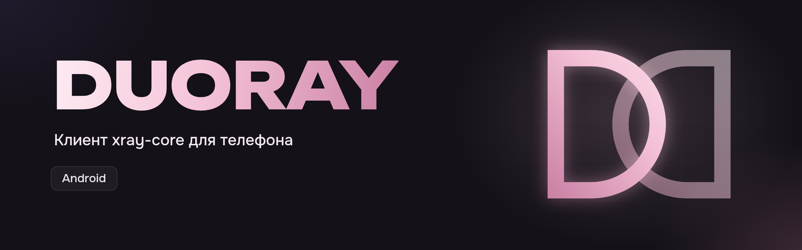
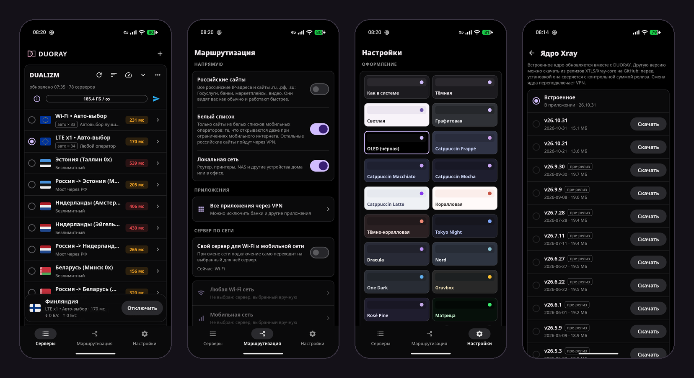

<p align="center">
  
</p>

<p align="center">
  <a href="https://github.com/m-a-prod/DUORAY-Mobile/releases/latest"></a>
  <a href="https://github.com/m-a-prod/DUORAY-Mobile/actions/workflows/android.yml"></a>
  <a href="LICENSE"></a>
  
</p>

**DUORAY для Android** — клиент [Xray-core](https://github.com/XTLS/Xray-core) для телефона,
мобильная версия [DUORAY](https://github.com/m-a-prod/DUORAY): те же подписки, ядро и
оформление, интерфейс под палец.

<p align="center">
  
</p>

## Возможности

**Подписки**
- Полные JSON-конфиги Xray без упрощений: балансировщики, мосты, маршрутизация и DNS
  панели сохраняются. Ссылки `vless://`, `vmess://`, `trojan://`, `ss://`, `hysteria2://`.
- Добавление по ссылке, по `duoray://` из Telegram-бота и по QR-коду: камера или картинка
  из галереи (скриншот с кодом).
- Метаданные панели: трафик и срок, объявление, автообновление, напоминание о продлении.
- Подмена HWID для отдельной подписки и режим совместимости с Happ.
- Редактор сервера: JSON-конфиг правится прямо в приложении и переживает обновление подписки.

**Подключение**
- Официальная сборка Xray-core читает TUN из VpnService сама (`xray.tun.fd`), без
  посредников. Приложение исключено из своего VPN.
- Пинг через сам сервер (HTTP GET/HEAD, режимы Default, Double, KeepAlive), TCP и ICMP;
  долгое нажатие на сервер — пинг одного. Отдельное число потоков для мобильной сети.
- «Держать подключение»: если сервер перестал отвечать, переход на самый быстрый.
- Постоянный VPN (always-on) Android и запуск без открытия приложения.
- Выбор ядра, как в MaterialXray: встроенное или любой релиз XTLS/Xray-core с GitHub,
  проверенный по контрольной сумме.

**Маршрутизация**
- Российские сайты, белые списки мобильных операторов и локальная сеть — напрямую.
- Приложения: все через VPN, все кроме выбранных или только выбранные — у каждого
  режима свой список.
- Закрепление серверов вверху списка и свой резерв: «Держать подключение» переходит
  на самый быстрый по пингу сервер из резерва.
- Подключаться без Wi-Fi: ушли с Wi-Fi на мобильную сеть — VPN подключается сам,
  вернулись — отключается (отдельный переключатель).
- Сервер по сети: свой для Wi-Fi, для мобильной сети и для отдельных Wi-Fi сетей;
  при смене сети подключение само переходит на нужный. Сервер, выбранный вручную,
  действует до смены сети.
- Режим работы: VPN, VPN + прокси или только прокси. SOCKS5 и HTTP-прокси — для
  приложений, где он указан, а с доступом через хотспот — и для устройств в той же
  Wi-Fi сети или на точке доступа телефона, с паролем или без. Только прокси
  работает без VPN, рядом с другим VPN (Tailscale и т. п.).

**Android**
- Уведомление показывает страну выхода с флагом, сервер, пинг, скорость и время;
  на Android 16+ это Live Update со значком в строке состояния (отключается).
- Плитка в быстрых настройках и ярлыки на иконке: «QR-код», «Подключить».
- Предиктивный жест «назад», экран от края до края, 120 Гц, тематическая иконка.
- 19 тем оформления, включая OLED.

**Обслуживание**
- Обновления приходят с сервера DUORAY, подписаны Ed25519 и ставятся по подтверждению.
- Отчёты об ошибках — только с согласия, без адресов серверов, ссылок и ключей.

## Установка

APK — в [Releases](https://github.com/m-a-prod/DUORAY-Mobile/releases/latest) и на
[duoray.pro](https://duoray.pro). Почти всем телефонам подходит `arm64-v8a`; `x86_64` —
для эмуляторов и редких планшетов. При первой установке Android попросит разрешить
установку из браузера или файлового менеджера, при первом подключении — VPN.
Дальше приложение обновляется само.

## Как устроено

```
Kotlin (android/)                      Rust (src/)
MainActivity : NativeActivity   ──►  android_main → Slint UI (ui/app.slint, app.rs)
DuorayVpnService : VpnService   ──►  Native.tunUp(fd) → service.rs → xray с fd TUN (tunnel.rs)
DuorayTileService, ярлыки       ──►  Native.toggle → подключение к последнему серверу
NetworkWatcher                  ──►  Native.networkChanged → сервер по сети (netpolicy.rs)
уведомление, плитка             ◄──  status.rs: страна, пинг, скорость
```

Подписки, ссылки и сборка конфигурации Xray — общее ядро `duoray-core` из
[DUORAY](https://github.com/m-a-prod/DUORAY); интерфейс — [Slint](https://slint.dev)
на Rust, оболочка Android — Kotlin.

## Безопасность и приватность

- API Xray слушает файл-сокет в каталоге приложения, а не порт на 127.0.0.1: другие
  приложения не могут ни найти его, ни управлять маршрутизацией. Локальный SOCKS для
  запросов самого приложения — со случайным логином и паролем.
- IPv6 без маршрута в туннеле блокируется Android и не уходит мимо VPN.
- Обновления проверяются по подписи Ed25519 и контрольной сумме до установки; APK
  подписан одним ключом, Android не даст поставить чужой поверх.
- Отчёты об ошибках отправляются только после явного согласия и отключаются в
  настройках; Xray-core — из официальных релизов с проверкой SHA-256.

О том, что VPN включён, Android сообщает всем приложениям сам: полностью скрыть его
можно только VPN на роутере. Сообщения об уязвимостях — в Telegram
[@dualizm_support](https://t.me/dualizm_support), а не в публичные Issues.

## Сборка из исходников

Рядом должен лежать репозиторий [DUORAY](https://github.com/m-a-prod/DUORAY): из него
берётся `duoray-core`.

```sh
git clone https://github.com/m-a-prod/DUORAY.git
git clone https://github.com/m-a-prod/DUORAY-Mobile.git
cd DUORAY-Mobile
rustup target add aarch64-linux-android x86_64-linux-android
cargo install cargo-ndk
export ANDROID_HOME=~/Android/Sdk ANDROID_NDK_HOME=~/Android/Sdk/ndk/<версия>
scripts/build-apk.sh debug        # или release
```

Скрипт скачивает последний релиз Xray-core с проверкой SHA-256, собирает
Rust-библиотеку и APK. Экраны можно смотреть без телефона:
`cargo run --bin duoray-preview`. Выпуск версии — `scripts/release.sh`.

## Лицензия

DUORAY распространяется по лицензии [GNU GPL v3](LICENSE). Сторонние компоненты
перечислены в [assets/NOTICE.md](assets/NOTICE.md).

---

<p align="center">Разработка — <b>DUALIZM</b> · <a href="https://t.me/dualizm_vpn">Telegram</a></p>
